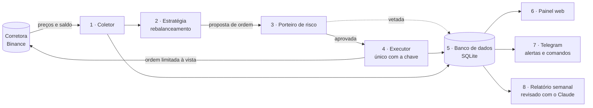

# Plano do Agente Cripto

Versão 1.1 · 25/11/2026 · funcionamento 100% autônomo, com notificações no Telegram

---

## 1. Objetivo e expectativa

**O que é:** um robô **100% autônomo** que administra uma carteira pequena de cripto na corretora de forma automática e disciplinada. Depois de configurado, ele funciona sem você precisar fazer nada e te informa de tudo pelo Telegram. Ele compra quando um ativo cai abaixo da proporção-alvo e vende quando sobe acima dela, usando **somente saldo próprio**.

**O que esperar, com sinceridade:**
- O resultado depende principalmente do preço do bitcoin. O robô não cria lucro do nada.
- A vantagem esperada do robô é **pequena**: dezenas de reais por ano sobre R$ 1.000. Ela aparece mais em mercados laterais e voláteis.
- É um projeto de **aprendizado com custo quase zero e risco limitado**, não uma fonte de renda.
- **Se o backtest mostrar que o robô não acrescenta nada, o projeto para ali**, sem ter custado dinheiro.

---

## 2. Regras que nunca mudam

1. **Só saldo próprio.** Sem margem, futuros, empréstimo ou qualquer outra forma de dívida.
2. **O robô nunca saca.** A chave de API não tem permissão de saque.
3. **Só ordens à vista (spot)** e **só ordens limitadas**, com preço máximo definido, nunca "a qualquer preço".
4. **Nenhuma trava pode ser afrouxada pelo próprio sistema.** Mudar limite exige ação manual sua.
5. **Na dúvida, não opera.** Dado velho, erro de API ou saldo inconsistente fazem o robô pausar.
6. **O capital é um valor que você aceita perder inteiro.**

---

## 3. Decisões já tomadas

| Item | Decisão | Motivo |
|---|---|---|
| Corretora | **Binance Brasil**. Alternativa: Foxbit. | Menor taxa (~0,1%), melhor API, exige restringir IP para negociar. Com capital pequeno, o efeito do imposto é mínimo. |
| Descartada | Mercado Bitcoin | Hack de cerca de US$ 49 milhões em novembro de 2026, com saques congelados. |
| Estratégia | Rebalanceamento com faixa de tolerância | Opera pouco (taxa baixa), é fácil de auditar e não precisa adivinhar o mercado. |
| Carteira-alvo | **50% BTC · 15% ETH · 35% em reais** | Poucos ativos, com reserva para comprar nas quedas. |
| Capital real | **R$ 1.000**, só na fase 3 | Suficiente para passar do mínimo de ordem e pequeno o bastante para um erro sair barato. |
| Servidor | **Oracle Cloud Always Free, região São Paulo** | Gratuito, IP fixo e fora dos EUA, o que a Binance exige. |
| Supervisor IA | **Sem API paga.** Revisão semanal feita nesta conversa com o Claude. | Custo zero. A estratégia funciona só com regras fixas. |
| Autonomia | **100% autônomo.** Nenhuma situação normal pede resposta sua. | Pedido seu. Nas quedas de mercado ele continua operando, porque é quando compra barato. |
| Acompanhamento | **Telegram:** cada operação, resumo diário, relatório semanal e alertas | Você acompanha tudo sem abrir nada. |
| Custo mensal | **R$ 0 de infraestrutura.** Só a taxa da corretora (centavos por mês). | Pedido de custo zero. |

---

## 4. Arquitetura



| Peça | Função | Proibido |
|---|---|---|
| **1 · Coletor** | A cada ciclo lê preços (BTC/BRL, ETH/BRL), saldo e ordens abertas. Marca o horário de cada dado. | Qualquer escrita. |
| **2 · Estratégia** | Calcula os percentuais atuais. Se algum ativo saiu da faixa, propõe a ordem que o traz de volta ao alvo. | Enviar ordem. |
| **3 · Porteiro de risco** | Confere cada proposta contra todas as travas da seção 6. Aprova ou veta e registra o motivo. | Ser contornado. |
| **4 · Executor** | Envia a ordem limitada, acompanha, reajusta o preço até 3 vezes ou desiste. Registra tudo. | Aceitar pedido que não venha do porteiro. |
| **5 · Banco de dados** | Guarda preços usados, propostas, vetos, ordens, execuções, taxas e saldos diários. | — |
| **6 · Painel web** | O console da maquete com dados reais: patrimônio, comparação com referências, travas, carteira e diário. Com login. | Ficar aberto sem senha. |
| **7 · Telegram** | Envia automaticamente cada operação, o resumo diário, o relatório semanal e os alertas (seção 9). Aceita os comandos opcionais `/status`, `/pausar`, `/retomar`, `/parar` e `/relatorio`. | Mudar limites. |
| **8 · Relatório semanal** | Gerado e enviado sozinho no Telegram. Se quiser minha análise, você encaminha para cá. | — |

---

## 5. Estratégia em detalhe

**Ciclo:** a cada 15 minutos. Rebalanceamento não precisa de mais que isso.

**Faixas de tolerância:**

| Ativo | Alvo | Faixa | Fora da faixa |
|---|---|---|---|
| BTC | 50% | 45% a 55% | Volta para 50% |
| ETH | 15% | 12% a 18% | Volta para 15% |
| Reais | 35% | É o que sobra | — |

**Execução de cada ordem:**
1. Envia uma ordem limitada no melhor preço do lado do livro em que ela espera ser executada (paga a taxa de quem oferta, que é menor).
2. Se não executar em 10 minutos, cancela e reenvia no novo melhor preço. No máximo 3 tentativas.
3. Depois disso, desiste e tenta de novo no próximo ciclo, se ainda for necessário.
4. Respeita o valor mínimo de ordem da corretora e ignora ajustes menores que R$ 20.

**Aporte mensal (opcional):** se você depositar todo mês, o valor entra como reais e o próprio rebalanceamento distribui.

**Fora da versão 1:** grade (grid), seguir tendência e outras moedas. Só entram se provarem valor em backtest próprio.

---

## 6. Travas de segurança

### Camada 1 · Na corretora (vale mesmo se o código tiver bug)
- Chave de API com **leitura e negociação à vista**. **Saque desligado.**
- Chave **restrita ao IP fixo** do servidor.
- **Conta de margem nunca ativada.** Futuros também não.
- Autenticação de dois fatores em toda a conta, e senha forte e exclusiva.

### Camada 2 · No código (o porteiro de risco)

| Trava | Limite | Ação |
|---|---|---|
| Valor por ordem | No máximo 15% do patrimônio | Veta |
| Operações por dia | No máximo 6 | Veta até o dia seguinte |
| Capital sob controle | Teto fixo, por exemplo R$ 1.050 | Ignora saldo acima do teto |
| Saldo suficiente | Nunca vende o que não tem nem compra sem reais | Veta |
| Dados velhos | Preço com mais de 2 minutos | Não opera |
| Volatilidade extrema | Movimento acima de 6% em 1 hora | Pausa novas ordens por 4 horas |
| **Robô pior que a carteira parada** | 5 pontos abaixo da mesma carteira sem operar | **Para sozinho** e avisa |
| **Queda do mercado** | Patrimônio 25% abaixo do pico | **Avisa e continua operando** normalmente. Não pausa nem vende tudo. Repete o aviso a cada 10 pontos a mais de queda. |
| Saldo inconsistente | Saldo da corretora diferente do esperado | Para e avisa |
| Erros seguidos de API | 3 seguidos | Pausa 1 hora e avisa |
| Margem ou dívida | Qualquer saldo negativo ou empréstimo detectado | **Para tudo** e avisa com urgência |

### Camada 3 · Na operação
- **Paradas automáticas:** só por motivo técnico (robô pior que a carteira parada, saldo inconsistente, sinal de dívida). Nesses casos ele cancela as ordens abertas, **não vende nada**, para e explica no Telegram o que houve.
- **Pausas temporárias** (volatilidade extrema ou erros de API) se resolvem sozinhas e são avisadas no Telegram.
- **Sinal de vida:** um monitor separado avisa no Telegram se o robô ficar 30 minutos sem responder.
- **Checagem a cada hora:** a chave continua sem permissão de saque e a conta segue sem margem.
- **Parada de emergência:** cancela as ordens abertas e desliga o robô. **Nada é vendido.**
- **Backup diário** do banco de dados.

---

## 7. Infraestrutura a custo zero

| Item | Solução |
|---|---|
| Servidor | Oracle Cloud Always Free, região São Paulo, menor máquina disponível, Ubuntu. |
| Linguagem | Python 3 |
| Comunicação com a corretora | Biblioteca **ccxt** (código aberto). Facilita trocar de corretora se precisar. |
| Banco de dados | SQLite, um arquivo só |
| Painel | Página web servida pelo próprio robô, com login |
| Alertas | Bot de Telegram, gratuito |
| Empacotamento | Docker, para reiniciar sozinho se o servidor reiniciar |
| Segredos | Chaves num arquivo `.env` no servidor, **nunca no GitHub** |
| Código | Este repositório no GitHub |

**Cuidados com a Oracle:**
- Máquina considerada ociosa pode ser recuperada pela Oracle (uso de CPU abaixo de 20% por 7 dias). A princípio, mudar a conta para "pague pelo uso" evita isso e continua gratuito dentro dos limites. **Confirmar antes.**
- Há relatos de falta de vaga em algumas regiões. Se acontecer, tentar de novo mais tarde.

**Plano B de servidor:** um computador seu que fique ligado. O problema é que o IP residencial costuma mudar, e a chave da Binance precisa de IP fixo.

---

## 8. Fases

### Fase 0 · Preparação (semana 1)
- [ ] **Você:** criar conta na Binance Brasil, concluir a verificação de identidade e ativar o 2FA. Ainda sem depositar.
- [ ] **Você:** criar conta na Oracle Cloud e escolher a região São Paulo.
- [ ] **Você:** criar um bot no Telegram e me passar só o nome dele. O token fica com você.
- [ ] **Eu:** montar a estrutura do código no repositório.

### Fase 1 · Backtest (semanas 1 e 2)
**Pergunta:** essa estratégia teria acrescentado alguma coisa de 2021 a 2026?

- **Dados:** velas de 1 hora de BTC/BRL e ETH/BRL, do arquivo público da Binance (data.binance.vision).
- **Custos simulados:** taxa de 0,1% mais 0,05% de diferença de preço em cada operação.
- **Comparações:**
  1. a mesma carteira 50/15/35 **parada**, sem rebalancear;
  2. **compra mensal de BTC** com o mesmo dinheiro;
  3. **100% BTC** comprado no início e segurado.
- **Contra o autoengano:** as faixas são decididas antes do teste. Os parâmetros são calibrados em 2021–2023 e validados em 2024–2026, que é um período que a calibração não viu. Também mostro como o resultado muda com faixas de 3, 5 e 10 pontos.
- **Medidas:** retorno total, maior queda, número de operações, taxas pagas e diferença contra cada referência, ano a ano.

**Avança se** ganhar da carteira parada, depois das taxas, no período de validação, ou empatar com queda máxima menor. **Senão, o projeto para.**

### Fase 2 · Simulado ao vivo (60 a 90 dias)
- Robô completo no servidor, com **preços reais e dinheiro de mentira**.
- Testa servidor, alertas, painel, travas e recuperação de falhas.
- Durante a fase, desligo o servidor de propósito e corto a internet, para ver se as travas funcionam.

**Avança se** passar 60 dias sem falha grave e com resultado coerente com o backtest.

### Fase 3 · Dinheiro real pequeno (60 a 90 dias)
- Depósito de **R$ 1.000** via Pix. Chave criada com as permissões da seção 6.
- Mesmo código da fase 2, trocando só a chave.

**Avança se** o resultado continuar coerente e as travas funcionarem na prática.

### Fase 4 · Continuidade
- Revisão mensal.
- Aumento de capital **só se você quiser**, em passos pequenos, e nunca dinheiro que vá fazer falta.

### Quando desistir, em qualquer fase
- O robô não ganha da carteira parada depois das taxas.
- Alguma trava falha.
- O projeto deixa de ser divertido ou útil para você.

---

## 9. Autonomia e notificações

### Funcionamento autônomo
Depois de configurado, o robô roda sozinho 24 horas por dia: coleta preços, decide, opera, se protege e reporta. **Nenhuma situação normal exige ação sua.** Os comandos do Telegram existem só se você *quiser* intervir.

### O que chega no Telegram

**A cada operação, na hora:**
```
🟢 COMPRA executada
0,00021 BTC por R$ 114,90 (R$ 547.140/BTC)
Motivo: BTC caiu para 44,8% da carteira (faixa 45–55%)
Taxa: R$ 0,11
Carteira agora: BTC 50% · ETH 15% · R$ 35%
Patrimônio: R$ 1.041,20
```

**Resumo diário**, às 21h, com horário ajustável:
```
📊 Resumo de 25/11
Patrimônio: R$ 1.041,20 (+0,8% no dia)
Operações hoje: 1 · Taxas: R$ 0,11
vs carteira parada: +0,3 ponto
Travas: todas OK
```

**Relatório semanal**, todo domingo: resultado da semana e desde o início, comparação com as três referências, operações, taxas e eventos de risco.

**Alertas**, só quando algo foge do normal:

| Tipo | Exemplo | O robô faz |
|---|---|---|
| ℹ️ Informativo | Queda de 25% desde o pico | Continua operando |
| ⏸️ Pausa temporária | Volatilidade extrema; corretora instável | Retoma sozinho |
| 🛑 Parada técnica | Saldo inconsistente; robô pior que a carteira parada | Cancela as ordens e para, sem vender nada |
| 🚨 Urgente | Sinal de dívida ou margem; chave com permissão indevida | Para tudo |
| 📵 Sem sinal | Robô sem responder há 30 minutos (monitor separado) | — |

Se for mensagem demais, dá para desligar o aviso de cada operação e manter só o resumo diário e os alertas.

### O que ainda depende de você
| Quando | O quê | Tempo seu |
|---|---|---|
| Uma vez | Configuração inicial: contas, chave de API e Telegram, com passo a passo | ~1 hora |
| Opcional | Encaminhar o relatório semanal para cá, se quiser análise | 2 min |
| Raramente | Resolver uma parada técnica junto comigo (o Telegram avisa) | Variável |
| Todo ano | Encaminhar a planilha de operações ao contador | 10 min |

---

## 10. Impostos e registro
- **Binance Brasil:** há indicação de que vale a isenção para vendas de até R$ 35 mil por mês, por ela ter CNPJ brasileiro, mas **não está confirmado**. No pior caso, 15% sobre o lucro. Com R$ 1.000 de capital o valor é muito pequeno. **Confirmar com o contador.**
- A MP 1.303, que acabaria com a isenção, caducou em 2025, mas o tema pode voltar ao Congresso.
- O robô gera uma planilha com todas as operações (data, ativo, quantidade, preço, taxa) para a declaração e para a DeCripto.

---

## 11. Riscos que continuam existindo

| Risco | Mitigação |
|---|---|
| Queda forte do cripto | Capital pequeno, 35% em reais, pausa em 25% de queda |
| A corretora quebrar ou travar saques | Deixar lá só o capital do robô |
| Bug no código | Travas na corretora, fases simuladas e limites pequenos |
| Chave de API vazar | Sem saque, IP restrito e chave fora do GitHub |
| A Oracle desligar o servidor | Monitor de sinal de vida avisando no Telegram, Docker e backup. Plano B: computador em casa. |
| Mudança no imposto | Acompanhar e revisar com o contador |

---

## 12. Estrutura do código

```
agente/
  config.py         # alvo, faixas e limites (só você altera)
  coletor.py        # preços e saldo (ccxt)
  estrategia.py     # cálculo do rebalanceamento
  risco.py          # porteiro: todas as travas
  executor.py       # único módulo que envia ordens
  banco.py          # SQLite
  painel/           # painel web
  telegram_bot.py   # notificações (operações, resumo, relatório, alertas) e comandos
  monitor.py        # monitor separado de sinal de vida
  relatorio.py      # relatório semanal e exportação para o contador
backtest/
  dados.py          # baixa o histórico público
  simulador.py      # roda a estratégia e as referências
  resultado.html    # gráfico e tabela do resultado
painel-ativos.html  # painel de mercado ao vivo (já feito)
PLANO.md            # este documento
```

---

## 13. Cronograma estimado

| Semana | Entrega |
|---|---|
| 1 | Fase 0 concluída e backtest rodando |
| 2 | **Resultado do backtest: seguir ou parar** |
| 3–4 | Robô completo, servidor no ar e simulado ligado |
| 5–16 | Simulado ao vivo, com revisão semanal |
| 17+ | Dinheiro real (R$ 1.000), se tudo passar |

---

## 14. Próximo passo

**Rodar o backtest.** Para isso, o ambiente de desenvolvimento precisa de acesso ao site de dados públicos da Binance (`data.binance.vision`). A liberação aparece para você aprovar.
