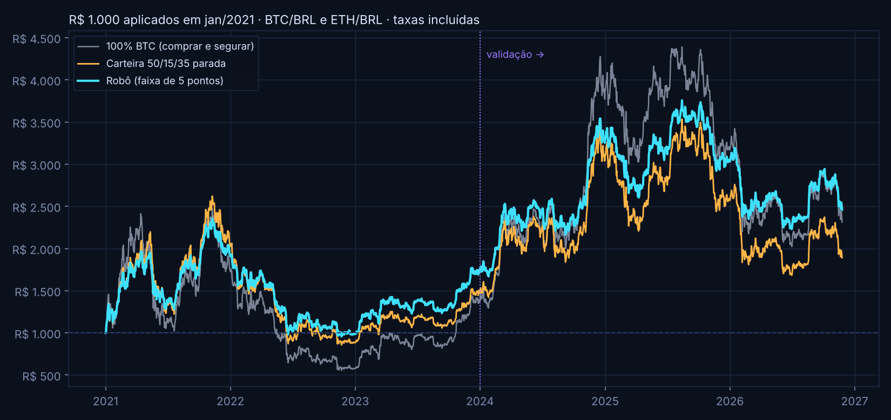

# Resultado do backtest · 25/11/2026

Dados: velas de 1 hora de BTC/BRL e ETH/BRL na Binance, de 01/01/2021 a 25/11/2026.
Capital: R$ 1.000. Custos: 0,1% de taxa mais 0,05% de diferença de preço em cada operação.
Carteira-alvo: 50% BTC, 15% ETH e 35% em reais.



## Retorno total (queda máxima · número de operações)

| Estratégia | 2021–2026 | Calibração 2021–23 | Validação 2024–26 |
|---|---|---|---|
| Carteira parada (sem rebalancear) | +89% (−68% · 2) | +47% (−68% · 2) | +32% (−48% · 2) |
| Rebalancear todo mês | +137% (−60% · 82) | +66% (−60% · 35) | +42% (−42% · 35) |
| Rebalancear a cada 3 meses | +168% (−60% · 39) | +81% (−60% · 17) | +48% (−42% · 19) |
| Rebalancear uma vez por ano | **+195%** (−58% · 11) | **+106%** (−58% · 6) | +43% (−42% · 6) |
| Robô, faixa de 5 pts (plano) | +146% (−60% · 59) | +72% (−60% · 39) | +40% (−41% · 17) |
| Robô, faixa de 10 pts | +149% (−60% · 17) | +75% (−60% · 13) | +45% (−40% · 7) |
| 100% BTC, comprar e segurar | +131% (−78% · 1) | +37% (−78% · 1) | **+67%** (−55% · 1) |
| BTC comprado em 12 meses | +52% (−78% · 12) | −10% (−78% · 12) | +9% (−55% · 12) |

## Conclusões
1. **Rebalancear vale a pena.** Qualquer forma de rebalanceamento ganhou com folga da carteira parada, com quedas menores.
2. **O robô não ganhou do rebalanceamento simples por calendário.** Rebalancear uma vez por ano ou a cada três meses empatou ou venceu o robô em todos os períodos.
3. **As quedas são grandes em qualquer estratégia:** cerca de −60% em 2021–2022.
4. **A trava "robô 5 pontos pior que a carteira parada" está mal desenhada.** Teria desligado o robô em fevereiro de 2021, porque dentro de cada ano o rebalanceamento costuma ficar um pouco atrás da carteira parada.
5. Taxas totais em quase 6 anos: R$ 7 (robô) e R$ 4 (anual). O custo não é problema.

## Limitações
- É um único caminho histórico. A ordem entre as estratégias pode mudar em outro período.
- O resultado do rebalanceamento anual depende da data escolhida (1º de janeiro).
- O robô foi simulado com checagem a cada hora; o plano previa a cada 15 minutos.
- Não inclui imposto.

## Como reproduzir
```
python dados.py <pasta>                  # baixa os dados (~51 mil horas)
python simulador.py <pasta>/velas_1h.csv resultado
python comparacao.py <pasta>/velas_1h.csv
python grafico.py resultado
```

---

# Concentração em BTC e ETH na alta · 25/11/2026

Pergunta: vale aumentar o alvo de Bitcoin e Ethereum quando a alta está confirmada, para não vender durante a subida?

Dados: velas de 1 hora das 6 moedas da carteira principal, de 18/06/2021 a 25/11/2026. Capital R$ 1.000, custo de 0,15% por operação, gatilho de 1 ponto, até 20 operações por dia, checagem a cada 4 horas.
Sinal de alta: fechamento diário acima da média de N dias, com 3% de folga para ligar e desligar. Vale a partir do dia seguinte.

| Regra | Total (média 200d) | Pior queda | 2023 | 2024 | 2025 | Total (média 100d) | Validação 2024–26 (200d / 100d) |
|---|---|---|---|---|---|---|---|
| Sem robô | +38% | −71% | +81% | +115% | −21% | +38% | +27% / +27% |
| Regra fixa (BTC 35 / ETH 15) | +91% | −65% | +98% | +107% | −11% | +91% | +43% / +43% |
| Freio de venda na alta (só vende com 5 pts) | +84% | −66% | +104% | +102% | −13% | +91% | +40% / +43% |
| **Moderada (BTC 45 / ETH 20 na alta)** | **+98%** | −68% | +111% | +122% | −14% | +121% | +50% / +58% |
| Forte (BTC 55 / ETH 25 na alta) | +107% | −69% | +120% | +132% | −16% | +123% | +51% / +65% |
| Quase tudo (BTC 65 / ETH 30 na alta) | +69% | −70% | +94% | +125% | −14% | +104% | +49% / +55% |

Conclusões:
1. Concentrar com moderação ganhou da regra fixa nos dois sinais e na validação, com queda máxima um pouco maior.
2. "Quase tudo" rendeu menos que a moderada: o sinal troca muitas vezes (24 no BTC, 18 no ETH com 200 dias) e cada troca errada custa caro.
3. O freio de venda não trouxe ganho.
4. O tamanho do ganho depende do sinal (200 ou 100 dias). É um único caminho histórico e o teste não inclui a reserva para quedas.

Decisão: o robô simulado adotou a **moderada com média de 200 dias**.

Reproduzir: `python tendencia.py <pasta>`
